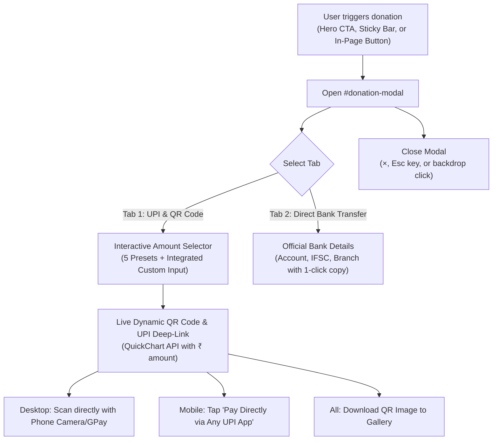

# Design Specification: Dedicated Donation Modal & In-Page Section Redesign

- **Date**: 2026-10-19
- **Status**: Approved by User
- **Author**: Antigravity Pair Programming Assistant
- **Target**: `otv-jain-temple-donation`

---

## 1. Problem Statement & Motivation
Currently, the donation section (`#donate-section`) sits directly on the main page with loosely positioned elements:
1. On laptops and wide screens, the preset amount chips (`.preset-chips`) are centered while the custom amount box (`.custom-amount-wrap`) floats awkwardly on a separate line with inconsistent alignment.
2. The page mixes amount chips, direct UPI links, a large QR button, and bank details in a long vertical stack, making the page look cluttered and disorganized.
3. On desktop, donors must click "View & Scan UPI QR Code" to open a separate bare modal, even though desktop users primarily donate by pointing their phone's camera at a QR code on the screen.

The user requested a clean, presentable redesign across devices: an elegant, dedicated **Donation Modal (Popup)** when clicking "Donate", coupled with a refined, dignified in-page **Sacred Contribution Overview Card**.

---

## 2. Proposed Architecture & User Flow

---

## 3. Detailed Component Specifications

### 3.1. In-Page Sacred Contribution Card (`#donate-section`)
The in-page section is transformed from a cluttered form into an authoritative, inspiring **Sacred Contribution Overview Card**:
- **Title**: Localized sacred appeal title (`data-i18n="donation_title"`).
- **Subtitle / Cause Highlights**:
  - Highlights renovation of the ancient 10th-century temple, Muni Maharaj Tyagi Niwas, and community hall.
  - Highlights the **50% Section 80G Tax Exemption** eligibility.
  - Highlights the **₹11,000+ Stone Plaque Tier** (donor name inscribed on permanent temple stone plaque).
- **Key Action Triggers**:
  - **Primary Button**: `⚡ நன்கொடை அளிக்க / Open Donation Portal` (`#open-donate-modal-btn`, `btn btn-gold btn-lg`) — launches the donation modal.
  - **Secondary Button**: `🏛️ வங்கி விவரங்கள் / Bank Transfer Details` (`#open-bank-modal-btn`, `btn btn-outline`) — launches modal directly to Tab 2.
- **Quick Credentials Pill**:
  - UPI ID: `f051m01588@indianbk` with instant copy button.
  - Bank quick summary: Indian Bank, Devikapuram Branch (A/C: `8350857706`, IFSC: `IDIB000D074`).

### 3.2. Dedicated Donation Modal (`#donation-modal`)
A full-featured, accessible, responsive modal dialog:
- **Header**:
  - Title: `🪔 1008 ஸ்ரீ விருஷபநாதர் ஜினாலயம் - திருப்பணி நன்கொடை` (`data-i18n="modal_donation_title"`).
  - Close button (`&times;`, `aria-label="Close dialog"`).
- **Navigation Tabs**:
  - **Tab 1: UPI & QR Code** (`tab-btn active`, icon: `📱`)
  - **Tab 2: Direct Bank Transfer** (`tab-btn`, icon: `🏛️`)
- **Tab 1: UPI & QR Code Content**:
  - **Unified Amount Selector Grid**:
    - 6-item responsive grid (`2x3` on mobile, `3x2` on desktop):
      1. `₹1,008` (Auspicious Jain denomination)
      2. `₹5,000`
      3. `₹11,000 ⭐` (Featured with special badge: `data-i18n="plaque_tier"`)
      4. `₹25,000`
      5. `₹50,000`
      6. **Custom Amount Input Box**: Seamless pill input matching chip dimensions, with `₹` prefix and numerical validation.
  - **Two-Column Layout on Laptop / Tablet (> 768px)**:
    - **Left Column**:
      - Amount selector grid.
      - UPI ID display pill (`f051m01588@indianbk`) with one-click copy and feedback toast.
      - Mobile UPI button (visible on touch devices / mobile viewports).
      - Section 80G & Plaque note.
    - **Right Column (Instant Scan on Desktop)**:
      - Prominently displays the live generated UPI QR Code (`quickchart.io` with dynamic amount).
      - Caption: *"Scan with GPay, PhonePe, Paytm, BHIM, or any banking app"*.
      - `📥 Download QR Image` button for convenience.
  - **Single-Column Stacking on Mobile (≤ 768px)**:
    - Amount chips on top.
    - Primary CTA: `📱 Pay Directly via Any UPI App` (`btn-upi-pay`).
    - Collapsible/expanded QR code section with `📥 Save QR to Gallery` and mobile scanning instructions.
- **Tab 2: Direct Bank Transfer Content**:
  - High-contrast, clean credential rows with 1-click copy:
    - Account Name: `1008 SHRI VIRSHABANATH BHAGWAN JAIN TEMPLE TRUST, OTHALAVADI`
    - Account Number: `8350857706` (with `📋 Copy` button)
    - Bank Name: `Indian Bank`
    - Branch: `Devikapuram Branch (Code 02322)`
    - IFSC Code: `IDIB000D074` (with `📋 Copy` button)
### 3.3. Mobile Floating Action Pill (FAB)
The existing bulky `.sticky-donate-bar` (which stretched 100% across the bottom with a 20-character email-like UPI ID and wrapped labels) is replaced with a sleek, modern **Floating Action Pill (FAB)**:
- **Position**: Fixed at the bottom-right corner of the mobile viewport (`bottom: 20px; right: 16px; z-index: 999;`).
- **Appearance**: Compact rounded pill (`border-radius: 30px`), vibrant gold with terracotta border and drop shadow (`box-shadow: 0 4px 16px rgba(139, 38, 19, 0.3)`).
- **Label**: `⚡ நன்கொடை / Donate` (`data-i18n="fab_donate"`).
- **Behavior**: Tapping it immediately launches the `#donation-modal`.
- **Space Efficiency**: Frees up 100% of the screen width, eliminates the bulky text collision, and ensures content remains completely readable as the user scrolls.

---

## 4. Localization & Symmetry (EN, TA, HI, KN)
All text elements will use `data-i18n` with 100% key symmetry across `en.js`, `ta.js`, `hi.js`, and `kn.js`:
- `modal_donation_title`: Modal header title.
- `tab_upi_qr`: UPI & QR Code tab title.
- `tab_bank_transfer`: Direct Bank Transfer tab title.
- `btn_open_donation_portal`: Primary button text on in-page card.
- `btn_open_bank_portal`: Secondary button text on in-page card.
- `donation_card_subtitle`: Highlighting temple cause, 80G benefit, and plaque eligibility.
- `scan_qr_instantly_hint`: Instruction to scan with phone camera / UPI app.
- Existing keys (`vpa_label`, `select_amount_label`, `plaque_tier`, `btn_copy_vpa`, `btn_pay_upi_app`, `btn_download_qr`, `qr_modal_tip`, `bank_details_heading`, etc.) preserved and reused.

---

## 5. CSS & Responsive Design Strategy
- **Modal Container**:
  - Centered flex/grid overlay with backdrop blur (`backdrop-filter: blur(4px)`).
  - Maximum width: `780px` on desktop, `100%` on mobile with `12px` margin.
  - Max height: `90vh` with smooth inner scrolling (`overflow-y: auto`).
  - Border radius: `16px` with subtle gold accent border (`border: 1px solid var(--border-gold)`).
- **Unified Amount Selector**:
  - Uses CSS Grid: `grid-template-columns: repeat(3, 1fr)` on desktop, `repeat(2, 1fr)` or auto-fit on mobile.
  - Custom amount input matches `.chip` styling: border, background, height, and border-radius.
- **Accessibility & UX**:
  - Keyboard focus trapping inside modal when opened.
  - Dismissible via `Esc` key and backdrop click.
  - Return focus to triggering button upon modal close.
  - Minimum touch targets: 44px on all interactive controls.

---

## 6. Testing & Verification Plan
1. **i18n Symmetry Test**: `node scripts/verify_i18n.mjs` verifying 100% key match across all 4 languages.
2. **DOM & Event Binding Verification**:
   - Clicking Hero CTA opens `#donation-modal`.
   - Clicking Sticky Mobile Bar button opens `#donation-modal`.
   - Clicking in-page `#open-donate-modal-btn` opens `#donation-modal` (Tab 1).
   - Clicking in-page `#open-bank-modal-btn` opens `#donation-modal` (Tab 2).
   - Selecting a preset chip updates the amount and refreshes QR code image.
   - Typing into custom input clears chip active states and updates QR code image.
3. **Responsive Visual Testing**:
   - Desktop viewports (1024px, 1280px, 1440px): 2-column balanced layout with immediate QR scan.
   - Mobile viewports (360px, 375px, 414px, 768px): clean stacked layout with touch-friendly primary UPI button.
4. **Master Verification Suite**: `npm run test:all` passing 100% without regression.
5. **Production Build**: `npm run build` compiling with 0 errors.
